# Orbit apps

Orbit OS ships with its own apps. Each one is a GTK 4 / libadwaita app written in Python or a GNOME Shell extension, built from this repository and themed from `branding/tokens.json`.

Every screenshot here is real:
- **Desktop shots** come from GNOME Shell 46 running headless with the Orbit packages installed (`tests/shell/run-desktop-shots.sh`).
- **App shots** come from the apps running under a virtual display with demo files (`tests/gui/screenshots.py`).
- **What's not from Orbit:** the build machine had a few extra apps (XTerm, Vim, ImageMagick) that appear in the app grid; they are not part of Orbit. The "Logged in as a privileged user" notice is there because the test session runs as root.

| | |
|---|---|
| 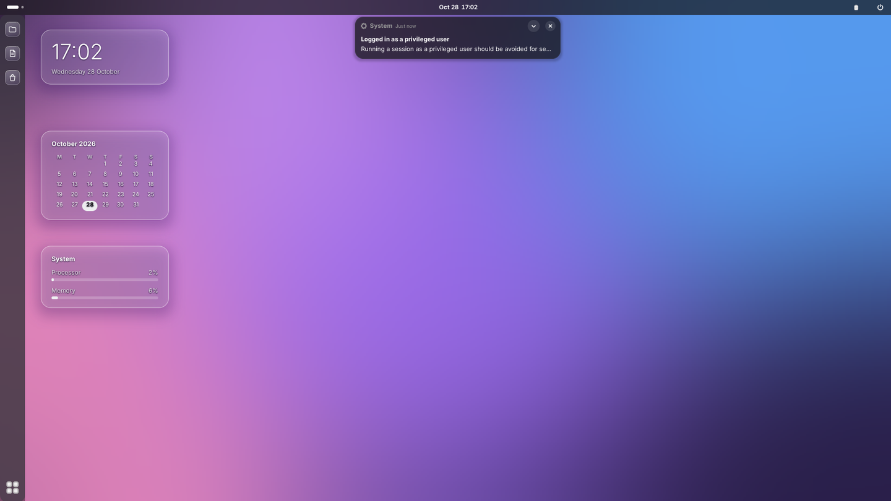 | 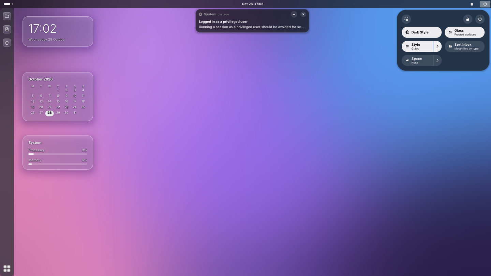 |
| The Glass desktop: dock, glass widgets, frosted top bar | Orbit toggles in Quick Settings |

## Keyboard shortcuts

| Keys | What it does |
|---|---|
| Super (tap) or Super+Space | Orbit Launcher: apps, files, settings, sums |
| Super+V | Clipboard history |
| Super+E | Orbit Files |
| Shift+Super+S | Screenshot an area and annotate it |
| Super+Alt+1 / 2 / 3 | Switch to Space 1 / 2 / 3 |
| Super+A | App grid |
| Super+M | Notification list (GNOME's own key; Super+V now opens the clipboard) |
| Super+D | Show the desktop (as on Windows) |
| Super+I | Settings (as on Windows) |
| Ctrl+Shift+Esc | Task Manager: Orbit Performance (as on Windows) |
| Alt+Tab / Super+Tab | Switch windows / switch whole apps |
| Super+← / → / ↑ | Snap a window left / right / maximize (GNOME's own, same as Windows) |

---

## Orbit Launcher (Super / Super+Space)
| | |
|---|---|
| 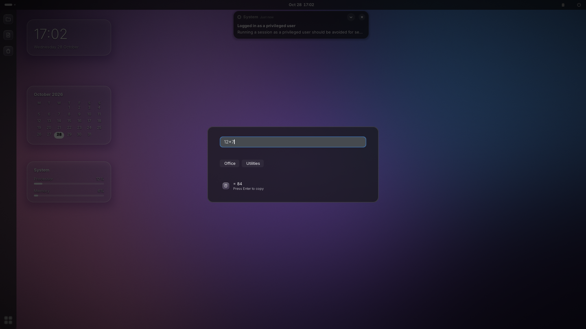 | 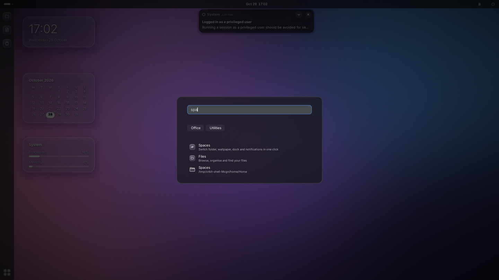 |

- Type to search apps, settings panels and files under `~/Home`.
- Type a sum (`12*7`, `2^10`, `(3+4)/2`) and press Enter to copy the answer.
- The chips above the results are your app folders (name, color, apps), stored in the extension settings.
- Searching files never uses an index or the network. It does a bounded walk: 3 levels deep, up to 400 entries.

## Orbit Files (file manager, Super+E)
| | |
|---|---|
| 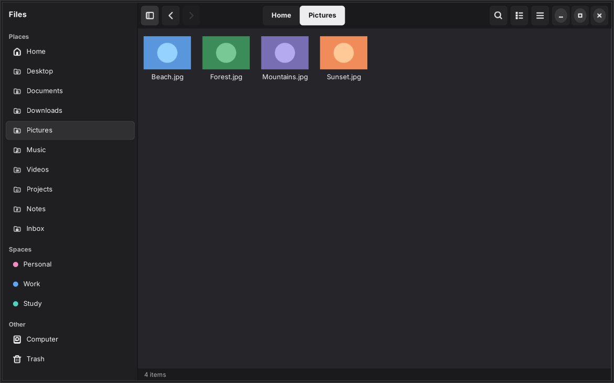 | 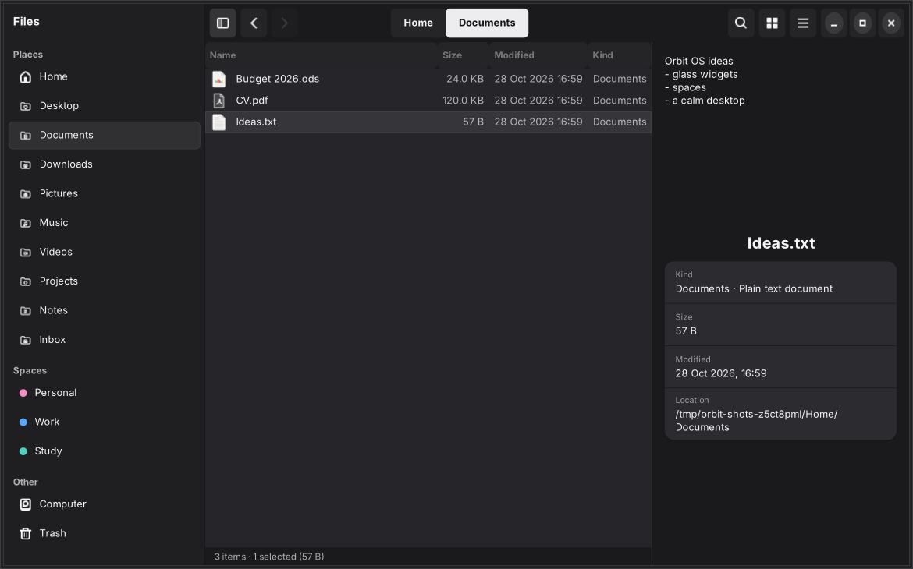 |

- **Layout:** a sidebar with Places, your colored Spaces, plugged-in drives (with eject) and the Trash. Above the files, a clickable path bar; Ctrl+L lets you type a path instead.
- **Views:** tabs (Ctrl+T), a grid with picture thumbnails, or a list with Size / Modified / Kind columns.
- **Preview pane** (Space): pictures, the start of text files, file details.
- **Search:** filter this folder as you type, or press Enter for *Search Everywhere* to search all subfolders.
- **Moving files:** drag and drop, or cut / copy / paste. These work with other apps too: copy in Orbit Files, paste in Firefox.
- **Trash with Undo:** a toast offers Undo after you delete. In the Trash you can restore to the original place or delete for good.
- **Compress / extract:** compress to ZIP, and extract ZIP or tar archives. Extraction blocks archives that try to write outside their folder.
- **Spaces and Inbox:** *Move to Space* in the right-click menu, and *Sort Inbox Now* when you are in `~/Home/Inbox`.
- **Properties:** with the full folder size, permissions and the app that opens the file.
- GNOME's own Files (Nautilus) stays installed. It gets the same *Move to Space* and *Sort Inbox Now* menu items through the Orbit add-on.

## Orbit Notes
| | |
|---|---|
| 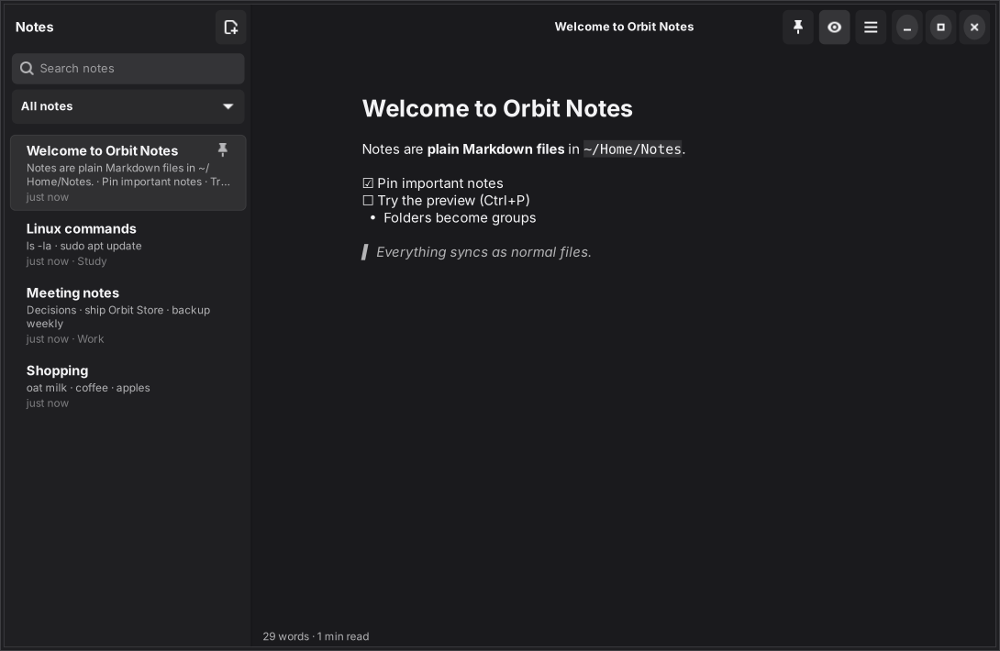 | 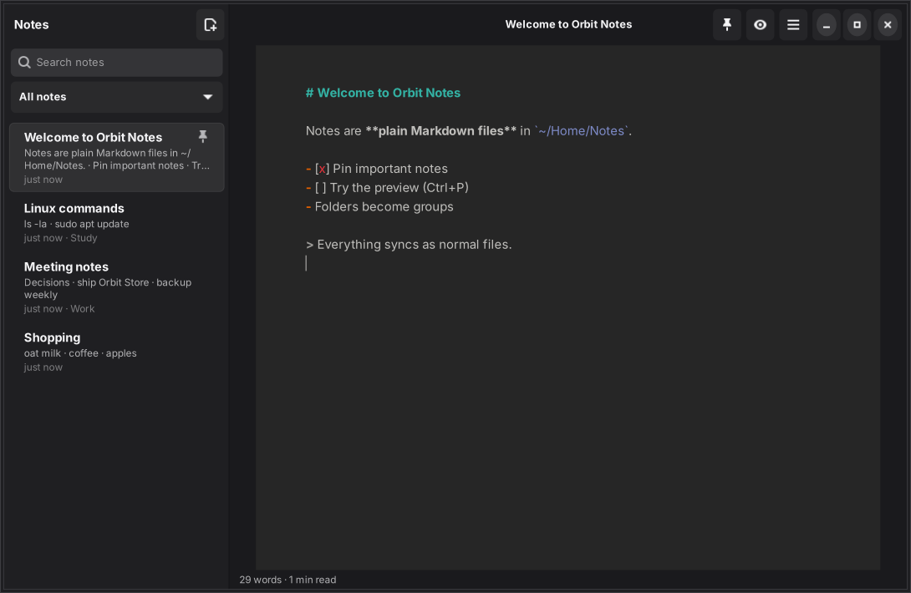 |

- **Plain files:** each note is a Markdown file in `~/Home/Notes`. Sub-folders become groups, and any editor or sync tool works with them.
- **Pinned notes** stay at the top of the list. Pins are stored in `~/Home/Notes/.orbit-notes.json`, so the notes themselves stay clean.
- **Editing:** Markdown highlighting, autosave 0.6 s after you stop typing (written safely, so a crash never leaves half a note), and a word count with reading time.
- **Preview** (Ctrl+P): headings, bold and italic, code, check lists, quotes and links. All text is escaped first, so a note can never inject markup.
- **Moving and trashing:** move notes between folders. Trashing a note offers Undo.
- **Outside edits:** if another program or a sync tool changes a note while it is open, Orbit Notes reloads it.

## Orbit Spaces
| | |
|---|---|
| 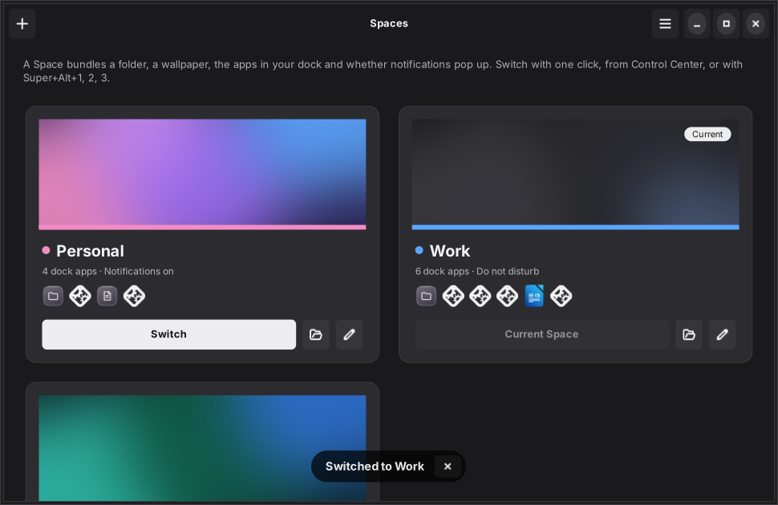 | 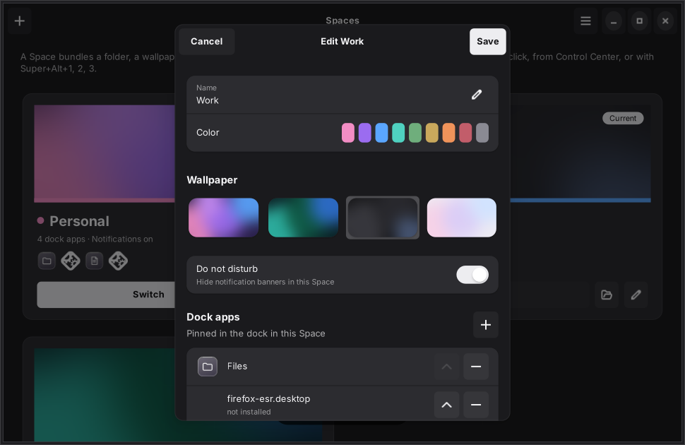 |

- **What a Space is:** a folder in `~/Home/Spaces`, a color, a wallpaper, the apps pinned in the dock, and *Do not disturb*. Switching applies all of them at once.
- **Ways to switch:** from the app, from Quick Settings → **Space**, with Super+Alt+1/2/3, or from a terminal:

  ```bash
  orbit-spaces list
  ```
  ```bash
  orbit-spaces switch Work
  ```
  ```bash
  orbit-spaces next
  ```
- **Renaming:** when you rename a Space, its folder is renamed with it. Deleting a Space never deletes its files.
- Settings are stored in `~/.config/orbit/spaces.json`.

## Orbit Screenshot (Shift+Super+S)
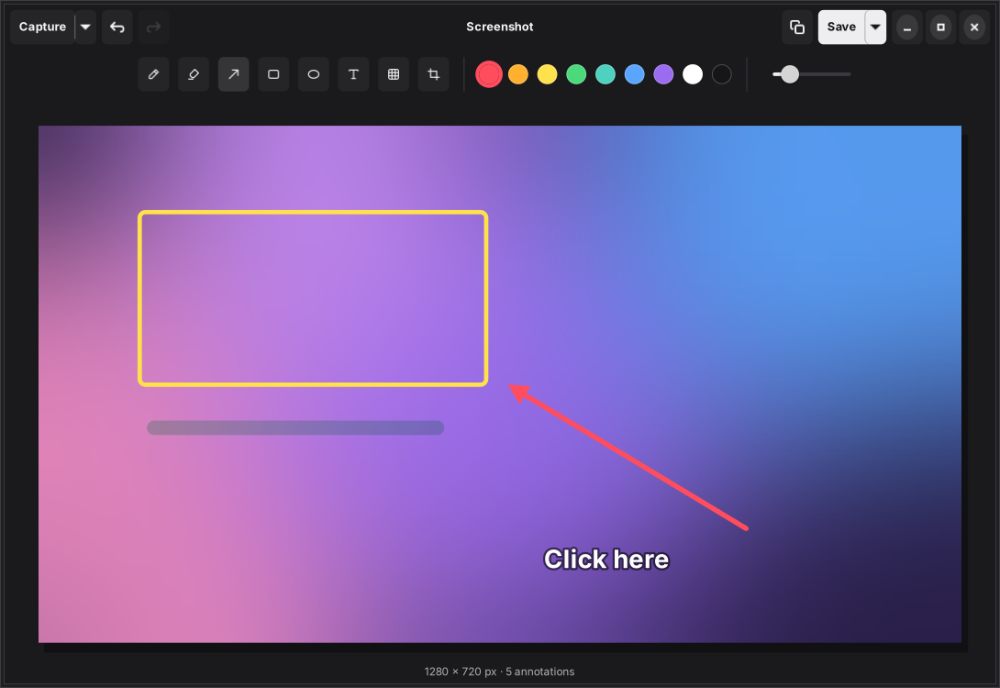

- **Capture** through the desktop portal, so on Wayland you get GNOME's normal area, window or screen picker. A delayed capture is also available.
- **Tools:** pen, highlighter, arrow, box, ellipse, text (with a halo so it stays readable on any background), pixelate and crop.
  - Pixelate is permanent in the saved image: use it for passwords or faces.
  - Undo and redo work for every tool, crop included.
  - The single-letter tool keys (P, H, A, R, E, T, X, C) only work while the image has focus, so typing in the text box can't switch tools.
- **Output:** save to `~/Home/Pictures/Screenshots`, use *Save As*, copy the image (Ctrl+C), or open an existing image to annotate it.

## Orbit Store
| | |
|---|---|
| 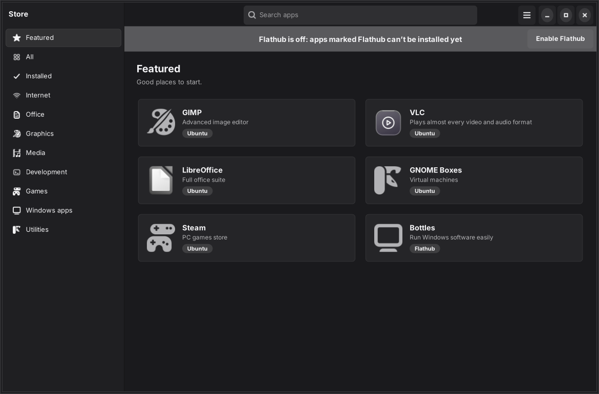 | 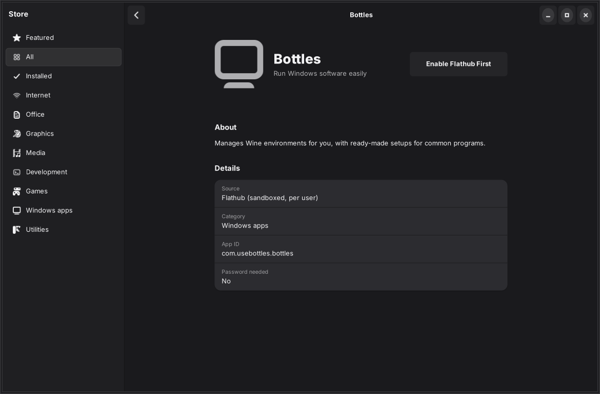 |

- **Catalog:** 43 hand-picked apps, from Debian's archive (signed by Debian) and Flathub (sandboxed). All 35 apt package names were checked against the Debian 13 (trixie) archive; Chromium is `chromium` there.
- **Debian apps** install through `pkexec orbit-store-helper`, which asks for your password once.
  - The helper re-reads the catalog itself and refuses any package that isn't in it.
  - Package names are passed after `--`, so they can never be read as apt options.
- **Flathub apps** install for your user only, with no password. If Flathub is off, the Store offers to turn it on.
- **Labels:** proprietary apps (Spotify, Discord, Obsidian) are labelled as such.

## Orbit Hardware
| | |
|---|---|
| 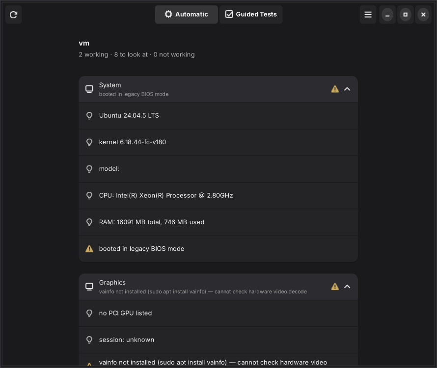 | 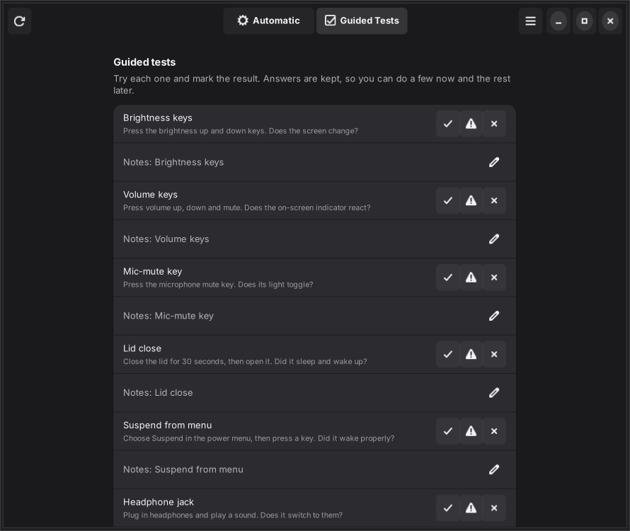 |

- **Automatic:** runs `orbit-hardware-check` (the same script as `tools/hardware-check.sh`). It changes nothing and sends nothing, and it marks each check green, amber or red.
- **Guided tests:** 13 checks a script can't judge, such as brightness keys, lid sleep, headphones, webcam, external monitor and fingerprint. You mark each one, and can come back later.
- **Report:** *Copy Report* or *Save Report* writes a Markdown table you can paste into `HARDWARE-TEST.md`.
- The screenshots show this cloud build machine, which is why it reports legacy BIOS and no GPU.

## Orbit Backup
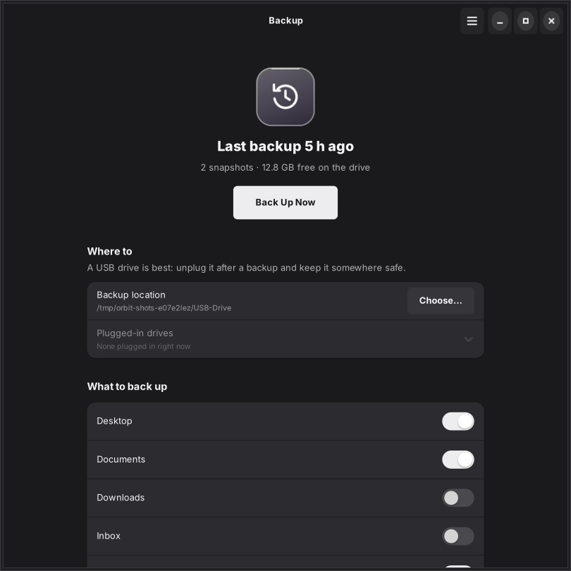

- **Snapshots:** backups go to a USB drive or folder, stored as `orbit-backup/<computer>/<date>/`.
  - Each snapshot is a complete copy you can browse in Files.
  - Unchanged files are hard-linked to the previous snapshot, so they take no extra space.
- **What to back up:** choose which `~/Home` folders, plus patterns to skip. Caches, `node_modules` and partial downloads are skipped by default.
- **Schedule:** manual, daily or weekly, through a user-level systemd timer. If the drive isn't plugged in, that run is quietly skipped.
- **Keeping snapshots:** set how many to keep; the oldest are removed after each new backup.
- **Restore** a whole snapshot or one folder. Restoring never deletes anything: files it would replace are kept as `name.before-restore`.
- **Limitation:** change detection uses rsync's normal check (size and modification time). A same-size edit made in the same second as a backup is only picked up at the next change.

## Orbit Updater
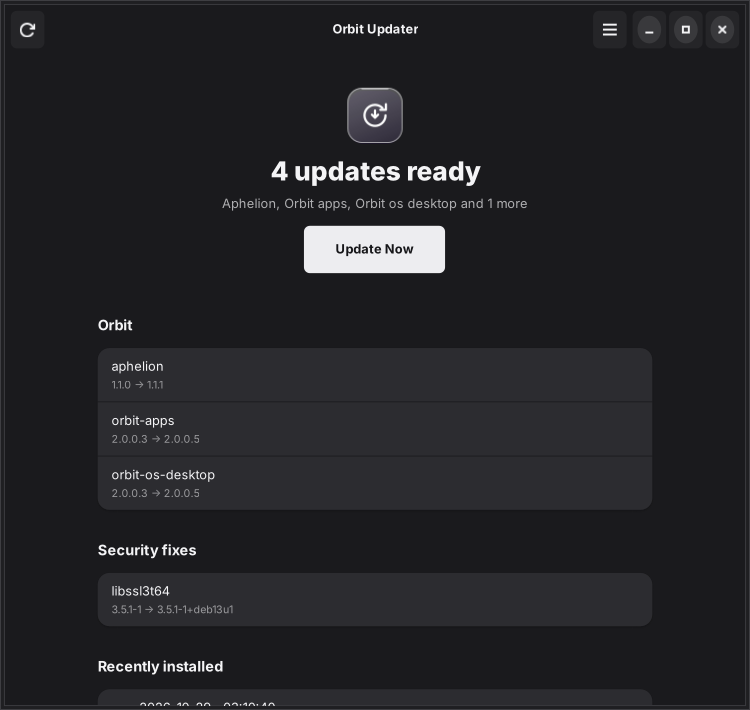

- Lists what can be updated: Orbit's own packages and Aphelion first, then Debian security fixes, then the rest. **Update Now** installs everything with a live progress bar (`pkexec orbit-updater-helper upgrade`, the same steps as `sudo orbit-update`).
- **Recently installed** shows the last update runs, including the automatic nightly ones.
- **Notifications:** `orbit-updater-check.path` fires the moment any update run finishes (this app, `sudo orbit-update` in a terminal, or the automatic updates) and says what was installed, or that it didn't finish. `orbit-updater-check.timer` checks every hour and says when new updates are ready. Each notification is sent once; clicking it opens Orbit Updater.
- **Safety snapshots:** before packages change, apt runs `orbit-snapshot pre-update` (`/etc/apt/apt.conf.d/40orbit-snapshot`). It takes a Timeshift snapshot of the system (rsync mode, hard links; your files in `/home` aren't included), at most once an hour and only when at least 15 GB is free. It keeps the newest 3 Orbit snapshots and never touches snapshots you made yourself. A snapshot problem never stops an update. The first snapshot is a full copy of the system (roughly 8–12 GB); later ones only store what changed.
- **Undo last update** puts the newest "before update" snapshot back (`pkexec orbit-updater-helper snapshot undo`) and restarts. The switch turns automatic snapshots off.

## Orbit Windows Apps
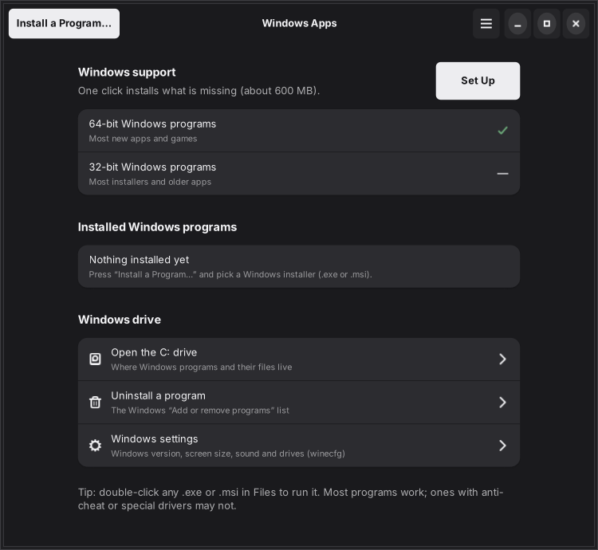

- **Double-click any .exe or .msi** (in Files, Downloads, a USB stick) and it runs with Wine, like on Windows. `orbit-windows FILE` is the default app for Windows programs (`/etc/xdg/mimeapps.list`). If something is missing, for example 32-bit support for an older installer, it says so in plain words and offers **Set Up**.
- **Install a Program…** picks an installer. Installed programs appear in the list with an Open button, and in the Launcher.
- **Windows drive:** open the C: drive (`~/.wine/drive_c`), uninstall a program (Wine's "Add or remove programs"), or change Windows settings (winecfg).
- New Orbit images ship Wine for 64- and 32-bit programs (`build.sh` enables Debian's i386 architecture). Systems installed earlier get 64-bit Wine with the next update, and **Set Up** (`pkexec orbit-windows-helper setup`) adds 32-bit support.
- Most programs work. Games with kernel anti-cheat, and programs that need their own drivers, usually don't.

## Windows networks
- **Files → Windows Network** shows Windows PCs and shared folders on your network (through GNOME Files, which asks for the Windows user name and password). Windows drives (NTFS) and USB sticks open like any other drive.
- The firewall lets replies from PCs on the local network in (`3702`, `5353`, `137` udp, from private addresses only), so they can be found. Until you turn on **Sharing**, this PC shares nothing and doesn't announce itself.
- OneDrive: Settings → Online Accounts → Microsoft 365 puts your OneDrive in Files.

## Orbit Focus
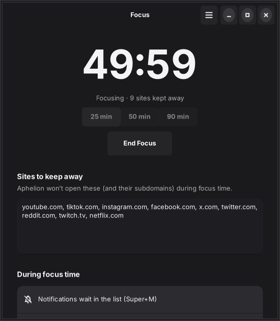

- Pick 25, 50 or 90 minutes and press **Start Focus**. Until the time is up, notifications wait in the list (Super+M) and Aphelion won't open the sites on your list or their subdomains; it shows a calm "Focus time" page instead. A notification says when the time is over.
- The site list is yours to edit (YouTube, TikTok, Instagram, Facebook, X, Reddit, Twitch and Netflix to start with).
- How it works: `~/.config/orbit/focus.json` holds the end time and the sites. Aphelion 1.2.1+ reads it only when it changes. A one-off systemd user timer (`orbit-focus --end`) puts notifications back when the time is up; **End Focus** does the same straight away.

## Phone Link
- Pair an Android phone: its notifications on the PC (and you can reply), send files both ways, one shared clipboard, texts, battery level, ring a lost phone, use the phone as a remote.
- On the phone, install **KDE Connect** (Google Play or F-Droid). On Orbit, open **Phone Link** (or Orbit Settings → Phone), pick the phone and press **Pair**; accept on the phone. Both must be on the same Wi-Fi.
- Built on GSConnect (Debian's `gnome-shell-extension-gsconnect`). The firewall lets KDE Connect in (ports 1714–1764) from private networks only.
- iPhones: KDE Connect for iOS can send files and share the clipboard; Apple doesn't allow notifications to be mirrored.

## Orbit VPN
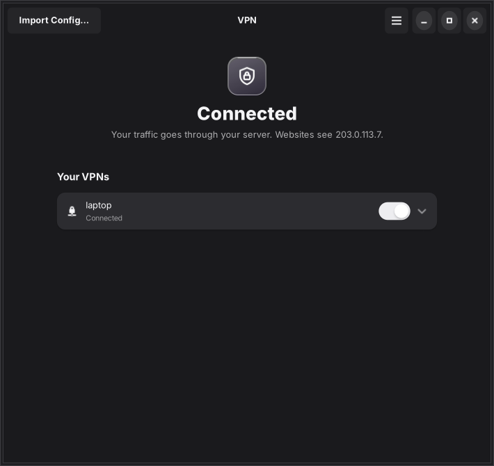

Your own VPN: your VPS runs WireGuard, and Orbit connects to it.

**On the VPS** (Debian or Ubuntu, as root):
```bash
git clone https://github.com/qitzblue2/OrbitOS && cd OrbitOS
sudo ./tools/orbit-vpn-server.sh setup          # once: WireGuard, keys, NAT, firewall (UDP 51820)
sudo ./tools/orbit-vpn-server.sh add laptop     # a config for one device, also shown as a QR code for phones
sudo ./tools/orbit-vpn-server.sh list           # devices and when they last connected
sudo ./tools/orbit-vpn-server.sh remove laptop  # that device can't connect any more
```
If your VPS provider has its own firewall in its web panel, allow UDP 51820 there too.

**On the laptop:** copy the config over (`scp root@YOUR-VPS:/etc/wireguard/orbit-clients/laptop.conf ~/Downloads/`), open **VPN**, choose **Import Config…** (or paste it), and switch it on. All traffic, IPv4 and IPv6, then goes through your VPS, and the window shows the address websites see. **Connect automatically** turns it on whenever the laptop goes online.

- Each device has its own key plus a pre-shared key. Removing one device never affects the others.
- The laptop side is NetworkManager's built-in WireGuard (`nmcli connection import type wireguard`). The private key is stored in NetworkManager's root-only settings, and the VPN also appears in the top-bar network menu.
- The config file holds the device's private key: delete the copy in Downloads after importing.

## Orbit Sync
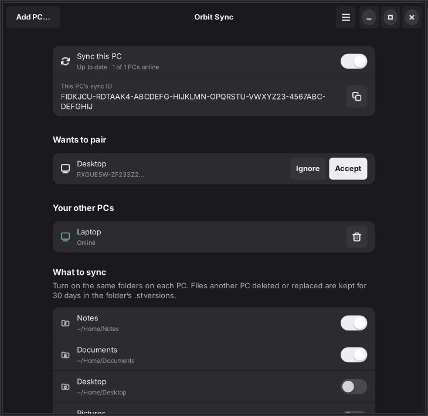

- Keeps Notes, Documents, Desktop, Pictures, Projects and Music the same on all your PCs. Turn on the same folders on each PC.
- **Pairing:** copy this PC's sync ID, then on the other PC choose **Add PC…** and paste it. This PC then shows the other one under **Wants to pair** with an **Accept** button.
- Built on Syncthing, running as your user (`systemctl --user`) with its control page on 127.0.0.1 only. PCs connect directly and everything is encrypted; when they aren't on the same network, Syncthing's relays carry the encrypted data along. There is no account, and no server that can read your files.
- Files that another PC deleted or replaced are kept for 30 days in the folder's `.stversions`.
- Tested end to end with two real Syncthing instances: pairing request, accept, a note written on one PC arriving on the other, and bad or own IDs refused.

## Orbit Sharing
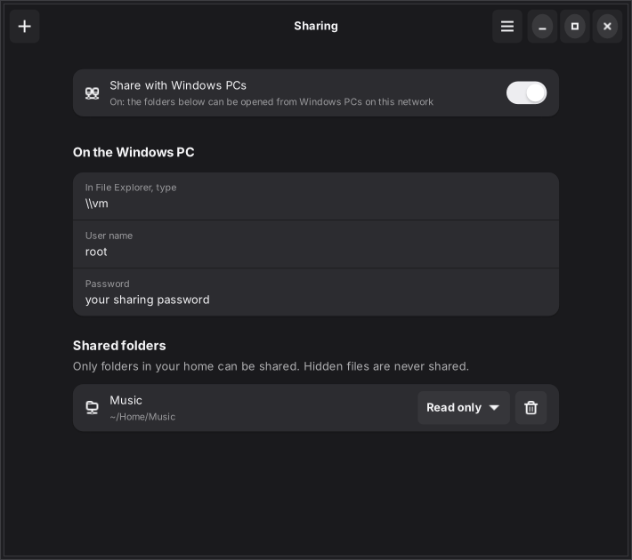

- One switch shares folders with Windows PCs on your network. Turning it on asks for a **sharing password**. On the Windows PC you type `\\your-pc-name` in File Explorer and sign in with your Orbit user name and that password. Password-less (guest) sharing isn't offered: Windows 11 refuses it, and it's unsafe.
- Add folders with **+**, or right-click a folder in Files → **Share with Windows PCs…**. Each folder is **Read only** unless you pick **Can change**.
- Only folders inside your home can be shared. Hidden folders (`.ssh`, browser profiles …) and hidden files are never shared, and links that point outside a shared folder aren't followed.
- Behind it, `pkexec orbit-sharing-helper` installs Samba when it's first needed and writes `/etc/samba/orbit-shares.conf` for your user only. It opens the firewall for SMB (445) and Windows' network view (5357) from private networks only, and starts announcing the PC. Turning the switch off stops all of that and closes the firewall again.

## Orbit Optimizer
| 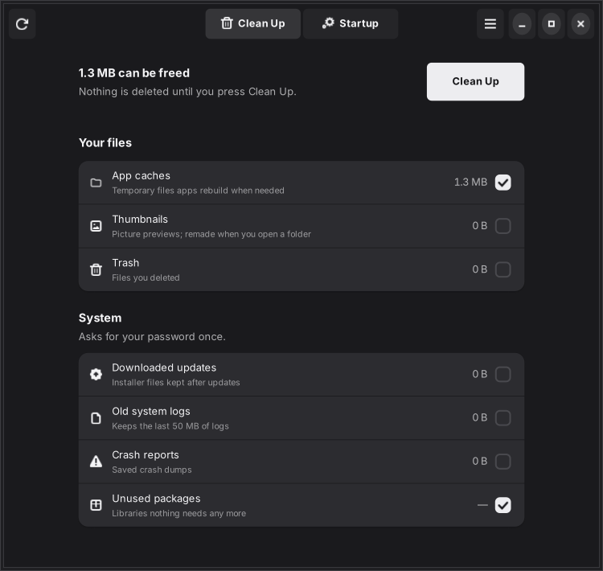 | 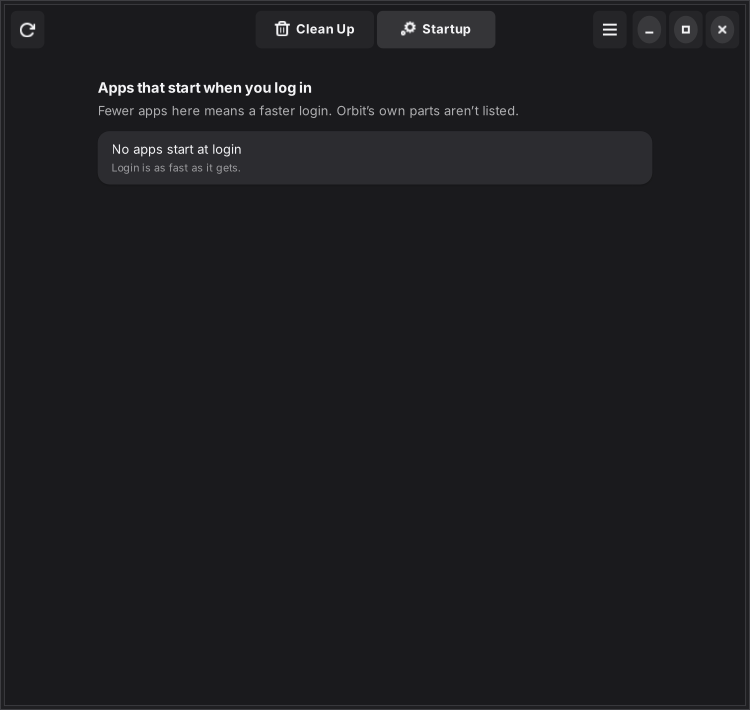 |
|---|---|

- **Clean Up:** measures first and deletes nothing until you press Clean Up. Your app caches, thumbnails and Trash are cleaned directly (Trash asks first). System files (downloaded updates, old logs over 50 MB, crash reports, unused packages) go through `pkexec orbit-tune-helper`, which only runs those four fixed jobs.
- **Startup:** turn apps that start at login on or off. This writes a per-user override in `~/.config/autostart`, so nothing system-wide changes. Orbit's own session parts aren't listed.

## Orbit Performance
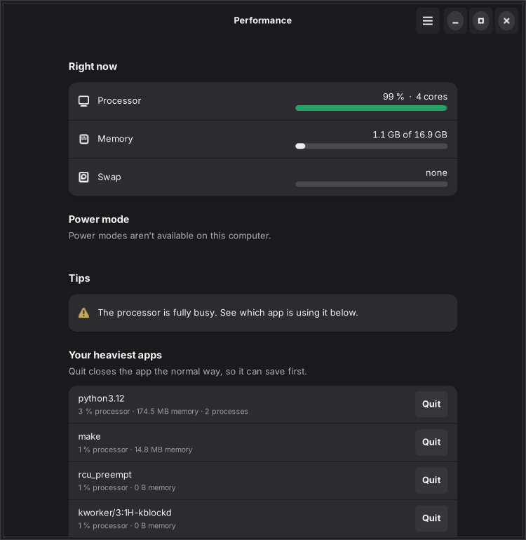

- Live processor, memory, swap and temperature, read every 2 seconds straight from `/proc` and `/sys`.
- Power mode (Battery Saver / Balanced / Performance) through power-profiles-daemon.
- Plain-language tips (memory almost full, running hot, too many login apps, lots to clean).
- Your heaviest apps with a **Quit** button. It asks the app to close normally, and only works on your own apps.

## Orbit Games
| 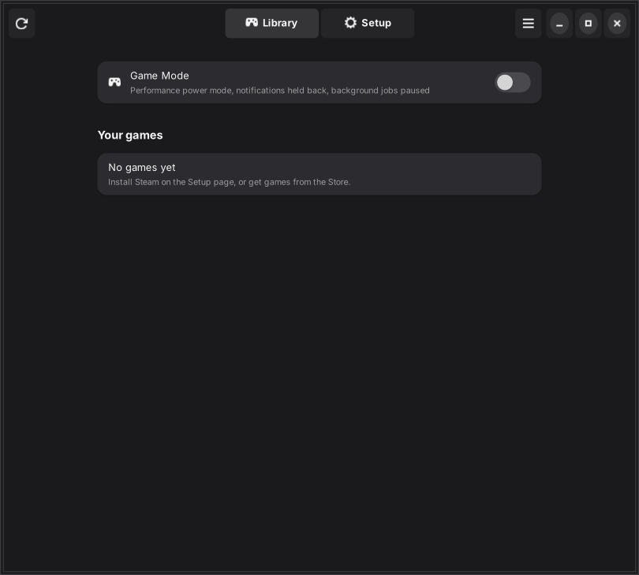 | 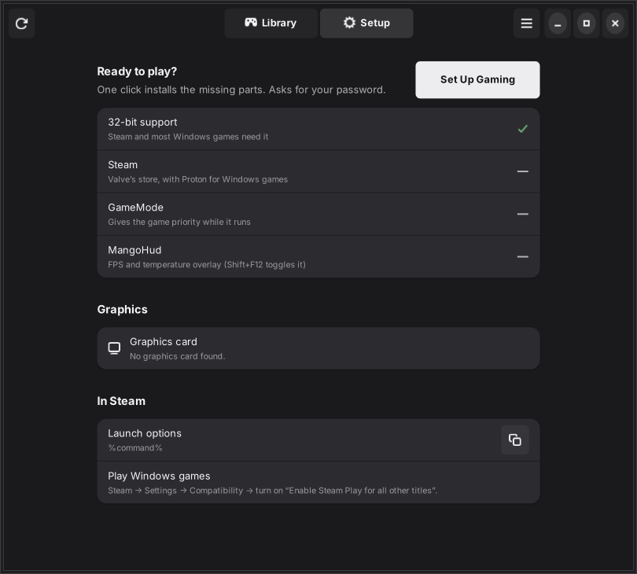 |
|---|---|

- **Library:** your installed games and game stores (Steam, Lutris, Heroic, Bottles) with Play buttons.
- **Game Mode:** one switch turns on the Performance power mode, holds back notifications and pauses Orbit's background jobs. Turning it off puts back exactly what was set before.
- **Setup:** shows what is ready. **Set Up Gaming** runs `pkexec orbit-games-helper setup`, a single fixed job: it turns on Debian's 32-bit packages and installs Steam, the 32-bit Mesa/Vulkan drivers, GameMode and MangoHud. It also shows the graphics card and gives the Steam launch options (`gamemoderun mangohud %command%`) with a copy button.
- Every Orbit image ships GameMode and `steam-devices` (controller and VR headset access without root). `vm.max_map_count` is raised for games that need it.

## Built-in speed tuning
Orbit ships these in `orbit-os-desktop`, so they also arrive as updates:
- Memory: zram first (`vm.swappiness=150`, `page-cluster=0`), folder metadata kept in cache, small write-back batches so copying to USB sticks doesn't stall the desktop, and `vm.max_map_count` raised for games.
- systemd-oomd closes a runaway app before the desktop freezes. Programs that hang at shutdown are stopped after 15 s instead of 90 s. The system log is capped at 200 MB.
- Disks: weekly TRIM for SSDs, and the right I/O scheduler per disk (NVMe `none`, SSD `mq-deadline`, hard disk `bfq`).
- Network: BBR congestion control with `fq`, TCP Fast Open. Boot doesn't wait for the network.

## GNOME Shell extensions

| | |
|---|---|
| 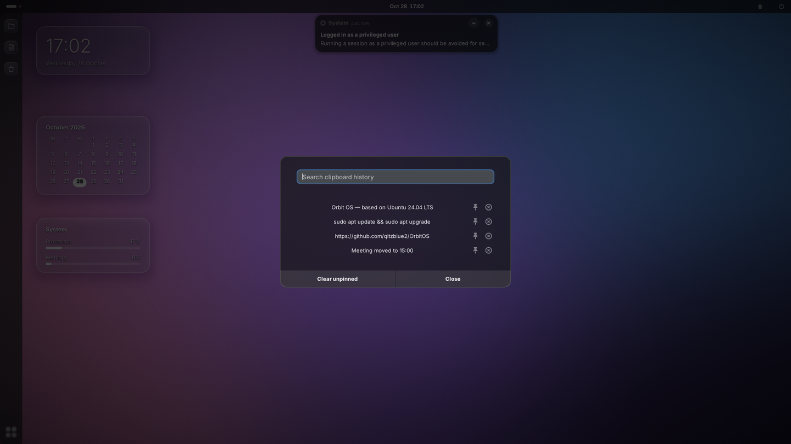 | 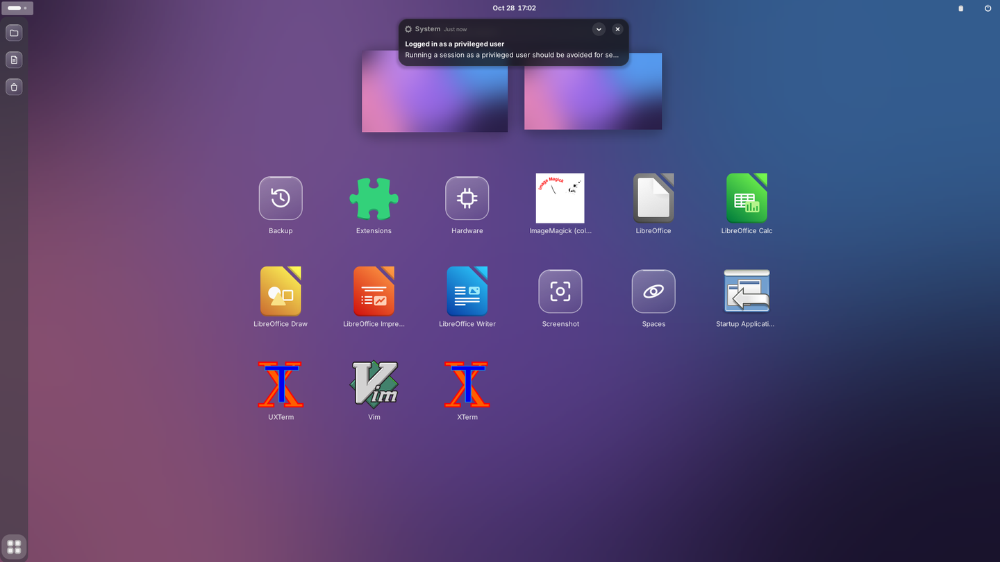 |

**Orbit Control Center** adds these toggles to Quick Settings:
- **Glass:** turns *Reduce transparency* on or off.
- **Style:** Glass, Graphite or Light.
- **Space:** lists your Spaces, marks the current one, and links to *Edit Spaces…*.
- **Sort Inbox:** turns automatic Inbox sorting on or off.

**Orbit Widgets** are glass cards on the desktop, above the wallpaper and below windows:
- **Cards:** clock, month calendar, and system (CPU, memory and battery).
- **Moving them:** drag a card to move it. Positions are remembered.
- **Reduce transparency:** with it on, the cards turn solid.
- **Weather** is **off by default**, because it is the only widget that uses the network. When on, it asks the free Open-Meteo service every 30 minutes, with your location rounded to about 1 km. Turn it on in Orbit Settings → Desktop widgets.

**Orbit Clipboard** (Super+V) keeps a clipboard history:
- **Using it:** search the history, pin items, forget single items, or clear everything unpinned. Choosing an item pastes it into the app you were using.
- **Privacy:**
  - Copies that a password manager marks (KeePassXC and others) are **never recorded**.
  - Nothing is recorded while the screen is locked or recording is paused.
  - Only **pinned** items are saved to disk (`~/.local/share/orbit/clipboard.json`, readable only by you). Unpinned history disappears when you log out unless you turn on *remember across sessions*.

## Where the code is
- `packages/orbit-apps/src/orbit/`: the apps. Each app's logic is kept separate from its window (`fileops.py`, `notes.py`, `spaces.py`, `backup.py`, `catalog.py`, `hardware.py`, `annotate.py`, `tune.py`, `games.py`, `updater.py`, `winapps.py`, `sharing.py`, `sync.py`, `snapshots.py`, `vpn.py`, `focus.py`), so it can be unit-tested.
- `packages/orbit-shell-extensions/`: Control Center, Widgets, Clipboard.
- `packages/orbit-launcher/`: the launcher extension.
- Tests:
  - Unit tests: `tests/test_orbit_apps.py`, plus `tests/*.test.mjs` for the extensions.
  - App scenarios: `tests/gui/scenarios/`.
  - Real-shell run: `tests/shell/`.
