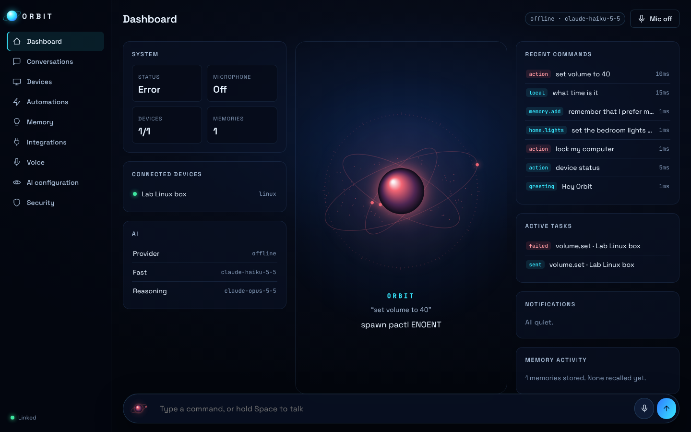

# ORBIT

A voice-first personal AI system. You talk to it ("Hey Orbit, start my gaming setup") and it runs your computers, smart home and information, with a clear permission model and an audit trail.



## The ORBIT app

ORBIT is a desktop app for **Windows, macOS and Linux**. Install it, and:

- **"Hey Orbit" is detected on your computer.** The wake word, speech recognition and ORBIT's voice all run on-device (sherpa-onnx). No audio is sent anywhere for them.
- **It works with the window closed.** ORBIT lives in the tray. Say "Hey Orbit" from any app and a small overlay appears at the top of the screen with what it heard and its reply.
- **Global push-to-talk:** press Alt+Space (⌥ Space on a Mac) anywhere, speak, then press it again.
- **This computer is set up automatically.** The app pairs itself as a device, so "open Spotify" or "lock my computer" works right away.
- **It can start when you log in**, so it's always available.

### Voices

Choose a voice on the **Voice** screen, then use **Preview** to hear it.
- **Built in:** Alan (British) and Lessac (American). Both are smooth 22 kHz voices that run on any computer.
- **Most natural:** 11 Kokoro voices, such as George, Emma and Adam. They share one 100 MB download and need a reasonably fast processor; ORBIT warns you if yours is too slow.
- **High quality:** Ryan, a 110 MB download.
- **Cloud:** each one needs that service's key, added under **AI configuration** in the **Voices** section of the provider list.
  - **Microsoft Azure:** 9 neural voices. Also enter your Speech resource's region, such as `eastus`. The free tier covers about 500,000 characters a month.
  - **Cartesia:** the Sonic voices on your account, which start speaking fastest.
  - **Hume:** the most expressive voices. ORBIT tells it to sound calm and composed.
  - **OpenAI:** 9 voices.

  If a cloud voice fails, or its free allowance runs out, ORBIT keeps talking with your last on-device voice and tells you once.

Speech is played gaplessly, with faded joins. Sentences are grouped into longer phrases so the intonation flows, and markdown, code and links are never read aloud.

### If ORBIT doesn't hear you or doesn't do anything

- **Voice › Microphone:**
  - **Test** shows whether ORBIT can hear you.
  - **Microphone** picks the right mic.
  - **Volume boost** helps quiet voices.
  - **Noise reduction** can be turned off if quiet speech is missed.
  - **Wait after I stop talking** keeps ORBIT from cutting you off mid-sentence.
- **Voice › Speech recognition:** switch to Groq Whisper (free tier) for better accuracy with names, accents and noisy rooms. "Hey Orbit" is still detected on your computer, and only your command is sent.
- **Devices › Check:** confirms ORBIT can reach and control the computer, and lists actions that are switched off. Locking, shutdown, messages and screenshots are off until you allow them under **Security**.
- **Speak naturally:** "Can you open Spotify for me?" works. With an AI key, looser requests such as "put some music on" or "make it quieter" are turned into commands too, and still go through the same permission checks.
- **On Windows:** apps open through the Start menu, so anything listed there, Microsoft Store apps included, opens by name.

### Choosing the AI model

- **Quick switch:** click the model name in the top bar to pick any model your keys can use. The list comes live from each provider.
- **By voice:** say "Orbit, switch to GPT-4o" or "Orbit, use Claude Sonnet". "Which model are you using?" tells you the current one.
- **Separate models:** in **AI configuration** you can pick one model for quick answers and another for deep reasoning, or type any model name under **Other…**.

### Get the installer

Open the repository's **Actions** tab, choose **Build ORBIT app**, and select **Run workflow**. When the run finishes, download your installer from its artifacts:
- `.exe` for Windows
- `.dmg` for macOS
- `.AppImage` or `.deb` for Linux

The builds aren't code-signed yet:
- **Windows:** SmartScreen asks you to confirm. Choose More info, then Run anyway.
- **macOS:** right-click the app and choose Open the first time.

### Add your AI keys

Open **AI configuration** and add as many keys as you like, from any of these:
- Anthropic (Claude)
- OpenAI
- Google Gemini
- Groq
- Mistral
- xAI (Grok)
- DeepSeek
- OpenRouter
- Poe (many models with one key, paid from your Poe points)
- Ollama (local and free, no key needed)
- any other OpenAI-compatible service

How ORBIT uses them:
- **Several keys for one provider:** ORBIT takes turns between them, which spreads out usage and rate limits.
- **Automatic failover:** when a key is rate-limited, out of credit or rejected, ORBIT pauses it and continues with your next key. If all of that provider's keys fail, it moves on to your other providers. This happens before any of the answer is spoken, so you won't hear two half-answers.
- **You choose which AI answers:** one provider and model for quick answers, and another for deep reasoning, code and screenshots.
- **Test button:** each key has one, which sends a tiny real request and reports back in plain words.
- **Privacy:** keys are encrypted on your computer (AES-256-GCM) and never shown again; the app only shows their last 4 characters. Device control, routines, smart home and memory work without any key.

### Run it from source

```bash
npm install
```

```bash
npm run models
```

This downloads the on-device speech models, about 150 MB, once.

```bash
npm run app
```

## Parts

ORBIT has three parts:

| Part | Folder | What it does |
|---|---|---|
| **Server** | `server/` | The intent router, the execution engine, the AI brain, memory, the device hub, smart home, automations and security. |
| **App** | `app/` | The desktop app: the embedded server, the on-device speech engine, the tray, the overlay, the global shortcut and the built-in Companion. |
| **Dashboard** | `web/` | The animated ORBIT core, the voice engine and nine control screens. It works on desktop and phone widths. |
| **ORBIT Companion** | `companion/` | A small agent you install on each computer. ORBIT acts on a machine only through its Companion, within the permissions you grant. |

## Server-only setup (advanced)

Use this to run ORBIT on a home server and control other machines with the standalone Companion. You need Node 20 or newer.

```bash
npm install
```

```bash
cp .env.example .env
```

Add `ANTHROPIC_API_KEY` to `.env` if you want ORBIT to answer open questions. Without a key, device control, routines, memory and the smart home still work. Questions get an honest "not connected" reply.

```bash
npm start
```

Open the printed URL and paste the dashboard token, which is also saved in `data/admin-token`.

To pair a computer, open **Devices** and select **Pair a new device**. Then, on that computer:

```bash
node companion/agent.js pair http://<orbit-host>:7777 <code> "My laptop"
```

```bash
node companion/agent.js
```

Then try a command: hold Space and say "open Spotify", or turn the mic on and say "Hey Orbit, lock my computer". Locking is off by default; grant it in **Security**.

## What happens when you speak

1. **Hear.** The browser voice engine detects the wake phrase or push-to-talk. Local voice-activity detection drives the core, end-of-speech detection and barge-in.
2. **Understand.** `server/intents.js` parses common commands locally, in microseconds, with no AI call.
3. **Route.** A command becomes an action. A question goes to the brain: the fast model for simple questions, the reasoning model for analysis, code, plans and screenshots.
4. **Resolve the target.** "On my gaming PC" picks a device by name or platform.
5. **Check permission.** The capability must be granted to that device on the server, and also allowed by the device's own local policy.
6. **Confirm.** Sensitive capabilities (messages, shutdown, commands) wait for "yes".
7. **Execute and verify.** The Companion runs the action and acknowledges it. ORBIT reports success only after that acknowledgement. A failure or silence is said plainly.
8. **Reply and log.** ORBIT gives a short spoken reply, streamed sentence by sentence, and writes an audit entry.

Measured on the dev box: greeting 1 ms, smart home 1 ms, a device status round trip 5 ms. That is well under the 300 ms target.

## Examples that work today

- **Devices:** "open Spotify and play my music", "turn my volume down", "set volume to 40", "open Chrome and search for today's news", "lock my computer", "take a screenshot", "why isn't this working?" (screenshot plus AI analysis), "device status", "turn on my computer" (Wake-on-LAN).
- **Home:** "turn off all the lights", "set my room lighting to 30 percent", "what's the temperature in my room?", "set the thermostat to 21".
- **Routines:** "activate movie mode", "start my gaming setup", "launch my development environment", "start goodnight mode". You can edit them under **Automations**.
- **Memory:** "remember that my sister is called Maya", "forget that…". You can review, edit and delete memories under **Memory**.
- **Proactive:** "good morning" gives a briefing. Reminders fire as notifications and are spoken.

## Tests

```bash
npm test
```

18 tests cover the intent parser, the on-device wake word and speech recognition, and the full server path:
- pairing
- authentication
- device commands over WebSocket
- honest failure and timeout replies
- permission enforcement
- confirmation of sensitive actions
- routines
- the memory sensitivity guard
- revocation

## Status

See [docs/ARCHITECTURE.md](docs/ARCHITECTURE.md) for the module map and for what is built versus planned.
