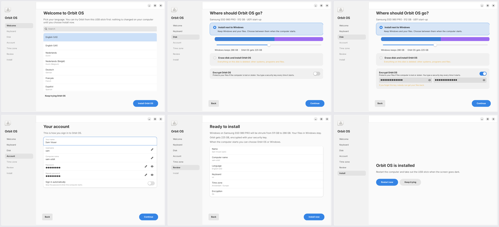

# Orbit OS

A personal Linux distribution built **from Debian 13 ("trixie")**, with its own installer. It has a calm GNOME 48 desktop with a frosted-glass look, its own apps, the **Aphelion** browser, a `~/Home` folder layout, a launcher on Super/Super+Space, and sane power and security defaults.

Debian provides the packages and security updates underneath; everything you see is Orbit's: theme, icons, boot menu, splash, login screen, apps, browser and installer.

> Status: personal project, **2.0 not built or booted yet**. See **[What was tested](#what-was-tested)** before you trust any of it on real hardware.


This screenshot is from Orbit 1.0 (GNOME 46). It has not been retaken on GNOME 48 yet.

## Orbit's own apps
**Files**, **Notes**, **Spaces**, **Screenshot**, **Store**, **Hardware** and **Backup**, plus the **Launcher**, **Control Center**, **Widgets** and **Clipboard** in the shell. See **[APPS.md](APPS.md)**.

| | | |
|---|---|---|
|  |  |  |

**Aphelion** (branch `Orbit-Apps`, folder `Orbit-Web`) is the default browser. It has a tracker shield, ad blocker, KeePass, 2FA codes, quick notes and reader view.

## The Orbit installer
Written for Orbit, from scratch (`packages/orbit-installer`). Its screens are Welcome, Keyboard, Disk, Account, Time zone, Review, then Install.

- **Install next to Windows:** shrinks Windows (NTFS) by the amount you choose. Your Windows files stay. Orbit reuses the Windows EFI partition and offers a boot menu.
- **Use free space:** puts Orbit into unpartitioned space and changes nothing else.
- **Erase disk:** you have to type `ERASE` to confirm.
- **Encryption:** optional full-disk encryption (LUKS2) for every option.
- **Plain-language summary:** shown before anything is written.
- **Refuses unsafe cases:** BitLocker, Windows in Fast Startup or hibernation, too little space. It explains each one.
- **Split design:** the window runs as you, and a small root engine does the disk work from one checked plan. Secrets never reach the log.



## Quick start
```bash
./build.sh
```
This builds the full ISO in a clean `debian:trixie` container (Docker or Podman). Use `sudo ./build.sh --host` on a Debian 13 VM instead.
```bash
tests/run-checks.sh
```
These are the fast checks: syntax, lint, unit tests and packaging. No root or VM needed.
```bash
sudo ORBIT_INSTALLER=1 tests/run-checks.sh
```
This also runs the real installer engine against throwaway loop-device disks: it erases, shrinks a real NTFS partition, and encrypts.
```bash
tests/vm-boot-test.sh out/orbit-os-2.0.0-full-amd64.iso
```
This boots the ISO in QEMU and passes only if the desktop appears.

Then follow **[INSTALL.md](INSTALL.md)**.

## How the image is made
```
build.sh                  A theme + icons → B Orbit .debs + Aphelion → C mmdebstrap Debian 13 (pinned snapshot)
                          + config/hooks → D live medium (kernel, live-boot initrd, squashfs) → E tools/make-iso.sh
config/build.conf         every pin: Debian suite, snapshot date, Aphelion branch, build container
config/packages/*.list    system, desktop, full, live package sets (Debian 13 names, all checked)
config/hooks/             10-system (identity, Aphelion default, firewall, zram, …), 30-live, 90-finish
tools/make-iso.sh         hybrid ISO: GRUB BIOS El Torito + Debian's Microsoft-signed shim/GRUB for UEFI
                          (Secure Boot), boots from DVD and from a USB stick written with dd/Etcher/Rufus
packages/                 orbit-os-branding, orbit-os-desktop, orbit-launcher, orbit-apps,
                          orbit-shell-extensions, orbit-installer
branding/tokens.json      every colour, size and timing; generate.py makes GTK, Shell/GDM, Plymouth, GRUB themes
icons/                    the Orbit icon themes (Glass, Graphite, Light)
skel/                     the ~/Home layout for new users
tests/                    run-checks.sh, test_installer_plan.py, installer_integration.py, gui/, shell/, vm-boot-test.sh
```

## Styles
`orbit-style glass|graphite|light` (also in **Orbit Settings**) switches the icons, shell theme and wallpaper together. **Reduce transparency** replaces every glass surface with solid colours.

## What was tested
- **Installer, planner:** 17 unit tests covering Windows laptops, BitLocker, BIOS and MBR disks, too-small disks and account validation.
- **Installer, engine:** the real engine ran on loop-device disks. It erased and partitioned a disk, shrank a real 100 GB NTFS partition to 60 GB with its files intact, reused the EFI partition without reformatting it, left the recovery partition alone and copied the system image. **Not tested here:** encryption (this sandbox's kernel has no device-mapper) and the final setup step (accounts, boot loader), which needs a built system.
- **Installer, screens:** every screen was clicked through in a dry run on a simulated Windows laptop.
- **Boot chain:** an ISO made by `tools/make-iso.sh` with Debian 13's real signed shim, GRUB and kernel was booted in QEMU from DVD and USB, in BIOS, UEFI and **UEFI with Secure Boot** (Microsoft keys). All reached the kernel.
- **Packages:** every package name was checked against the Debian 13 archive.
- **Not tested yet:** the full ISO, which has not been built (on request), GNOME 48 with the Orbit extensions, and real hardware. See [HARDWARE-TEST.md](HARDWARE-TEST.md).

## Honest limits
- Security updates come from Debian (trixie is supported until about mid-2028, then Debian LTS). There is no Orbit security team.
- The installer's language list sets the system language. The installer's own screens are English only for now.
- Under Secure Boot, GRUB shows its plain text menu (lockdown blocks custom fonts and themes). Without Secure Boot it shows the Orbit theme.
- Windows programs do not run natively. Anti-cheat games and many DRM apps will not run.
- Only what is marked ✅ in HARDWARE-TEST.md has been checked on real hardware.

Docs: [UPDATES](UPDATES.md) · [APPS](APPS.md) · [DECISIONS](DECISIONS.md) · [INSTALL](INSTALL.md) · [HARDWARE-TEST](HARDWARE-TEST.md) · [PERFORMANCE](PERFORMANCE.md) · [SECURITY](SECURITY.md) · [LICENSES](LICENSES.md)
